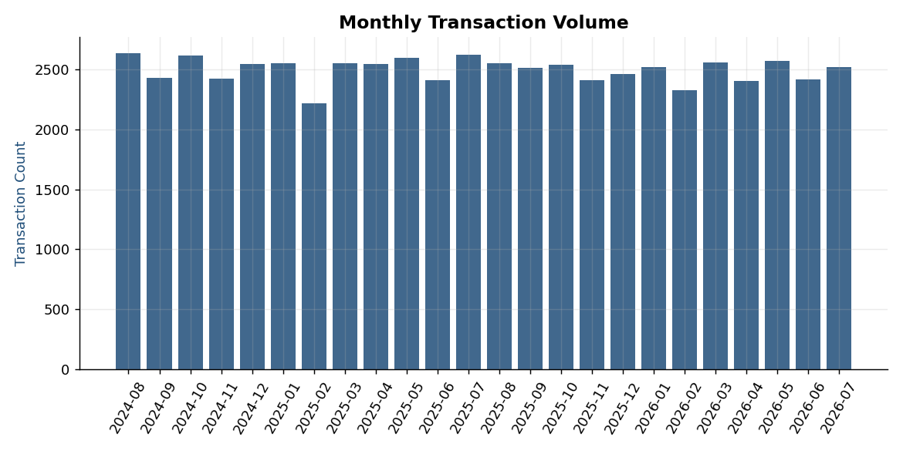
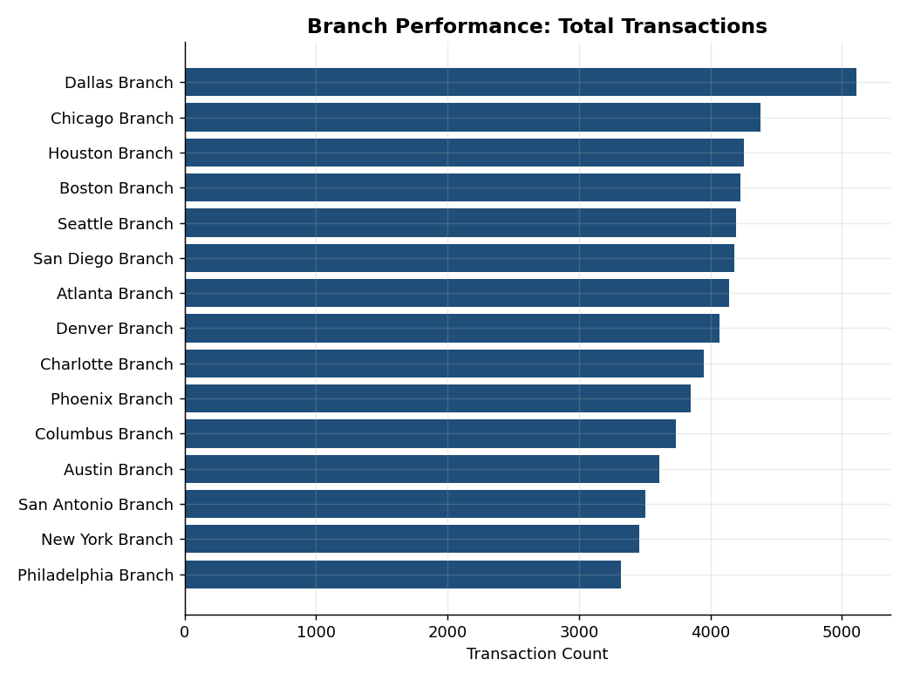
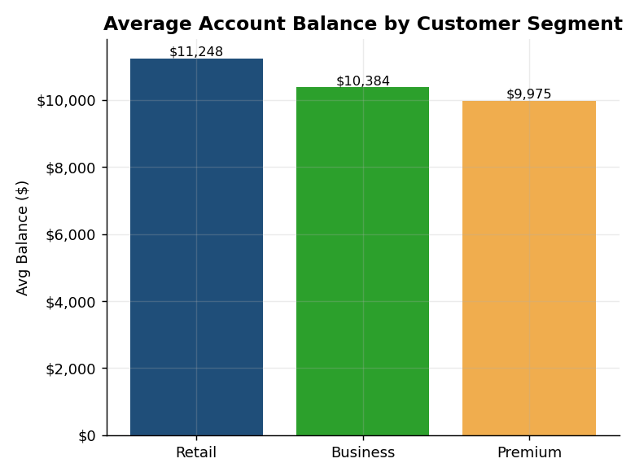
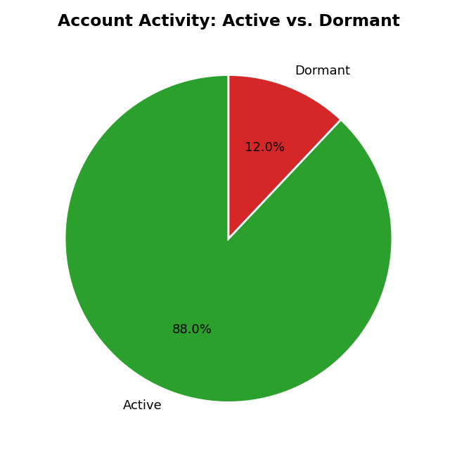

# Business Performance Analysis for a Digital Banking Platform

**July 2026 – Present**

End-to-end business analytics project simulating a digital banking
platform's transaction, customer, branch, and account data. Built to
demonstrate a full analytics workflow — from data modeling through SQL and
Python analysis to interactive Power BI dashboards and an Excel KPI
summary — for evaluating customer behavior, transaction trends, branch
performance, and account activity.

> **Tools used:** SQL (SQLite/PostgreSQL-style) · Python (pandas, matplotlib)
> · Power BI · Excel

---

## Project Overview

Digital banks generate enormous volumes of transactional and behavioral
data. This project analyzes that data to answer questions a bank's
business/operations team would actually ask:

- Which branches and regions are driving the most transaction volume and
  fee revenue?
- How is digital channel adoption (Mobile/Web) trending vs. branch and ATM
  usage?
- Which customer segments are most valuable, and where are the revenue
  opportunities?
- How many accounts are dormant, and what's the re-engagement opportunity?
- What does month-over-month growth in transactions and net cash flow look
  like?

The result is a set of KPIs and an interactive dashboard that support
data-driven decisions around branch resourcing, customer engagement
campaigns, and revenue growth.

## Key Insights (from the sample dataset)

| KPI | Value |
|---|---|
| Total Customers | 2,000 |
| Total Accounts | 2,600 |
| Active Account Rate | 88.0% |
| Total Transactions (24 months) | 60,000 |
| Total Fee Revenue | $70,634.89 |
| Average Account Balance | $10,925.09 |
| Digital Channel Share (Mobile + Web) | 64.9% |

**Highlights:**
- Digital channels (Mobile App + Web Banking) account for nearly **2 in 3**
  transactions, ahead of Branch, ATM, and Call Center combined —
  reinforcing continued investment in digital self-service.
- **12% of accounts are dormant**, representing a clear re-engagement /
  win-back revenue opportunity (flagged explicitly in `sql/03_advanced_analysis.sql`).
- Business and Money Market accounts carry disproportionately high average
  balances relative to their share of the account base, making them a
  high-value segment for relationship banking.
- Branch performance varies meaningfully by region, supporting targeted
  staffing/resourcing decisions.

## Dashboard Previews

| Monthly Transaction Volume | Branch Performance |
|---|---|
|  |  |

| Segment Avg Balance | Account Dormancy |
|---|---|
|  |  |

*(Add Power BI screenshots here once built — see `powerbi/dashboard_guide.md`.)*

## Repository Structure

```
digital-banking-performance-analysis/
├── README.md
├── data/
│   ├── branches.csv
│   ├── customers.csv
│   ├── accounts.csv
│   ├── transactions.csv
│   └── banking.db                # SQLite DB built from the CSVs above
├── sql/
│   ├── 01_schema.sql             # Table definitions + indexes
│   ├── 02_kpi_queries.sql        # Core business KPI queries
│   └── 03_advanced_analysis.sql  # Window functions, CTEs, cohort/risk analysis
├── python/
│   ├── 01_data_generation.py     # Generates the synthetic relational dataset
│   ├── 02_eda_analysis.py        # EDA, KPI computation, chart generation
│   ├── 03_build_excel_workbook.py# Builds the Excel KPI workbook (live formulas)
│   └── requirements.txt
├── excel/
│   └── banking_kpi_summary.xlsx  # KPI dashboard workbook (SUMIFS/COUNTIF/AVERAGEIF-driven)
├── powerbi/
│   └── dashboard_guide.md        # Step-by-step Power BI build guide (relationships, DAX, layout)
└── images/                       # Chart & dashboard screenshots
```

## Data Model

Four related tables simulating a real banking system:

- **branches** — branch_id, name, city, region, open_date, staff_count
- **customers** — customer_id, name, age, segment (Retail/Premium/Business), home_branch_id, signup_date, credit_score
- **accounts** — account_id, customer_id, account_type (Checking/Savings/Money Market/Business), open_date, current_balance, status (Active/Dormant), branch_id
- **transactions** — transaction_id, account_id, customer_id, branch_id, transaction_date, transaction_type, channel, amount

> The dataset is **synthetically generated** (see `python/01_data_generation.py`,
> seeded for reproducibility) to mirror realistic banking patterns —
> segment-based balance profiles, channel adoption skew toward mobile, and a
> deliberate ~12% dormant-account rate for engagement analysis. No real
> customer or account data is used.

## How to Reproduce

```bash
# 1. Install dependencies
pip install -r python/requirements.txt

# 2. Generate the synthetic dataset (writes to /data)
cd python
python 01_data_generation.py

# 3. Run EDA + generate charts (writes to /images)
python 02_eda_analysis.py

# 4. Build the Excel KPI workbook
python 03_build_excel_workbook.py

# 5. Explore in SQL — load data/banking.db in any SQLite client,
#    or run the queries in /sql against your own database
```

For the Power BI dashboard, follow `powerbi/dashboard_guide.md` to connect
to the CSVs (or `banking.db`), build the data model, and recreate the DAX
measures and report pages.

## Tech Stack

- **SQL** — schema design, joins, window functions (`LAG`, `RANK`), CTEs,
  and KPI aggregation queries
- **Python** — `pandas` for data generation/wrangling, `matplotlib` for
  visualization
- **Power BI** — data modeling, DAX measures, interactive cross-filtered
  dashboards
- **Excel** — formula-driven KPI summary workbook (`SUMIFS`, `COUNTIF`,
  `AVERAGEIF`) for stakeholders who prefer a spreadsheet view

## License

This project uses entirely synthetic data and is shared for portfolio /
educational purposes.
